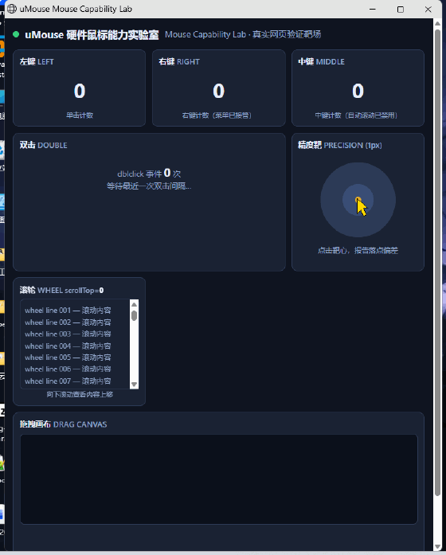

# uMouse MCP — 面向 AI 智能体的硬件鼠标控制

[English](README.md) | **简体中文**

[](https://github.com/SonicloudTech/mouse-mcp/releases/tag/v0.1.1)
[](LICENSE)

[](#语音听写asr-provider-可插拔)

让 AI 智能体握住一只**真实的硬件鼠标**。uMouse MCP 是面向 Windows 的 Model Context Protocol（MCP）服务器，通过 USB HID 实现鼠标控制，并提供语音听写。移动、点击、滚动和拖拽经兼容的 uMouse 设备执行；语音输入支持可插拔的语音识别服务。

**需要兼容的 uMouse 硬件与固件、Windows x64，以及单独安装的 Node.js 运行时（使用 Node.js 22 x64）。** 普通 USB 鼠标不能直接替代。原生 SDK 二进制与采用 MIT 许可的服务器代码有不同的许可范围，详见[许可](#许可)。

[下载](#下载) · [快速开始](#快速开始) · [参考演示](#参考演示) · [文档](#文档) · [获取硬件与支持](#硬件与支持) · [uMouse SDK](https://github.com/SonicloudTech/mouse-sdk)

## 下载

| 发布包 | 下载入口 | 使用要求 |
|---|---|---|
| MCPB · Windows x64 · v0.1.1 | [下载 MCPB](https://github.com/SonicloudTech/mouse-mcp/releases/download/v0.1.1/umouse-mcp-0.1.1-win-x64.mcpb) · [版本说明与 SHA-256](https://github.com/SonicloudTech/mouse-mcp/releases/tag/v0.1.1) | 支持 MCPB 的客户端；兼容 uMouse 硬件；x64 Node.js 22+ |
| Windows x64 · v0.1.0 | [下载 ZIP](https://github.com/SonicloudTech/mouse-mcp/releases/download/v0.1.0/umouse-mcp-os-win-x64-0.1.0.zip) · [版本说明与 SHA-256](https://github.com/SonicloudTech/mouse-mcp/releases/tag/v0.1.0) | 兼容的 uMouse 设备与固件；单独安装 Node.js |

[全部版本](https://github.com/SonicloudTech/mouse-mcp/releases) · [Gitee 发布镜像](https://gitee.com/SonicloudTech/mouse-mcp/releases/tag/v0.1.0)

**MCPB 安装：** 在支持 MCPB Node 扩展的客户端中导入 `.mcpb`。0.1.1 封装旧版 0.1.0 运行文件，不含云端凭据，语音识别默认 `disabled`，可选本地 `windows-speech`。数据默认存入 `~/.umouse-mcp-mcpb`，详见 [MCPB 中英文指南](mcpb/README.md)。Registry 元数据名称为 `io.github.SonicloudTech/mouse-mcp`，定义于 [`server.json`](server.json)，参见[发布与验证说明](mcpb/PUBLISHING.md)。

ZIP 包内包含生产环境 Node 依赖、原生 SDK DLL、语音预览浮窗和 VC 运行库。使用发布包无需执行 `npm install` 或编译；**包内不含 Node.js 本身**。

**发布包与源码采用不同的安装路径：** v0.1.0 安装器注册的是旧版 stdio 入口 `mcp/dist/index.js`。下文的共享 v2 工具、原生宿主与验收实验室属于源码实现。此 ZIP 不包含该原生宿主与验收实验室，不能作为完整的共享 v2 发布包使用。发布版的具体能力以已安装服务器提供的工具列表及 ZIP 内随附 README 为准。

## 快速开始

以下步骤使用原 ZIP。MCPB 请按上文导入，再执行第 5 步的状态与设备检查。

1. 安装 Node.js 22 x64，确认 `node --version` 可运行。连接兼容的 uMouse USB 接收器或设备并打开鼠标电源。设备与固件兼容性确认见[硬件与支持](#硬件与支持)。
2. 下载上方 ZIP 并解压，打开 `umouse-mcp-os-win-x64` 文件夹。请将其放在固定位置，客户端配置会引用此目录。
3. 双击 `install-agents.cmd`，默认注册到 **ZCode 用户级配置**；或在解压目录中为所用客户端选择执行**一条**命令：

| 客户端 | PowerShell 命令 |
|---|---|
| ZCode | `node mcp/scripts/install-agents.mjs zcode` |
| Claude Desktop | `node mcp/scripts/install-agents.mjs claude` |
| Cursor | `node mcp/scripts/install-agents.mjs cursor` |

安装器会添加或更新所选客户端配置中的 `umouse` 条目。若本地尚无 ASR 配置，还会将包内试用配置复制到本地数据目录。正式使用请替换为自己的凭据。

4. 根据所选客户端，新建 ZCode 会话、完全退出后重启 Claude Desktop，或重载 Cursor 窗口。
5. 让智能体依次调用 `umouse_status`、`umouse_get_capabilities` 和 `umouse_list_devices`，核对 SDK 状态、设备列表与报告的能力。返回 `sdkVersion` 仅代表 SDK 可访问，**不代表硬件反控已生效**；实际请求鼠标操作后，还应确认屏幕上的可见结果。

对于接受 `mcpServers` JSON 格式的客户端，可手动添加以下条目，并将路径替换为实际解压目录。其他客户端可能使用不同的配置格式。

```json
{
  "mcpServers": {
    "umouse": {
      "command": "node",
      "args": ["C:\\path\\to\\umouse-mcp-os-win-x64\\mcp\\dist\\index.js"]
    }
  }
}
```

手动配置不会运行安装器的 ASR 初始化。需要语音听写时，请另行配置识别服务，详见[语音听写](#语音听写asr-provider-可插拔)。

源码开发时，`npm ci`、`npm run build` 和 `npm test` 分别安装依赖、编译 TypeScript 和运行默认测试，并不生成完整的共享 v2 原生发布包。目前尚未提供完整的共享 v2 公开打包流程；[共享 v2 开发与维护说明](mcp/SHARED-V2.md)和[原生宿主构建说明](mcp/sdk-host/README.md)用于这一独立开发路径的参考。

## 参考演示

鼠标实验室录屏展示的是共享 v2 源码实现，不是旧版 ZIP 安装路径。

真实硬件鼠标驱动实验室页面（金色箭头为录屏叠加的系统光标）——页面上的计数、滚轮位置与命中反馈均由浏览器真实事件产生，非脚本伪造：



### 语音打字：说出的话，实时打进任意窗口

按住设备语音键说话，松开后识别文字经真实键入链路打进**此刻的前台窗口**——不挑应用，光标在哪就打到哪里。以下两段均为实机录制（1080p）：

**Agent 客户端（终端）**——语音命令逐字打进终端并回车执行：

<video src="mcp/acceptance/demo/voice-typing-agent.mp4" controls muted width="720">mcp/acceptance/demo/voice-typing-agent.mp4</video>

[打开或下载视频](mcp/acceptance/demo/voice-typing-agent.mp4)

**微信**——语音文字逐段打进输入框并发送：

<video src="mcp/acceptance/demo/voice-typing-wechat.mp4" controls muted width="720">mcp/acceptance/demo/voice-typing-wechat.mp4</video>

[打开或下载视频](mcp/acceptance/demo/voice-typing-wechat.mp4)

## 共享 v2 能力（源码实现）

> 大模型 → MCP 宿主 → 共享守护进程（`:47192`）→ C++ 原生宿主 → USB HID `0xF0/0xF1` → uMouse 设备 → Windows 输入管线

- **硬件动作**：`umouse_mouse_action` —— move / click / scroll / drag，桌面物理像素坐标，支持多屏与负坐标，可选 `precision: standard | high`。
- **任务独占**：`umouse_control` begin → 动作 → end；同一时刻只有一个任务驾驶键鼠，断线自动收尾。
- **读数传感器**：`umouse_input_status` —— 光标坐标、全键实时状态、前台窗口身份；只读，不拦截。
- **语音听写**：麦克风采集 → VAD 分段 → 可插拔 ASR provider → 预览 / 终稿回执，独立链路，与键鼠反控互不抢占（见下文）。
- **共享 daemon**：单机单实例（端口 47192），ZCode / Codex / Claude 多宿主共用，空闲自动回收。

## 语音听写：ASR provider 可插拔

ASR 在这里不是绑死某家服务的黑盒，而是一个很小的接口约定——实现 `begin / writePcm / finishInput / cancel` 四个方法，回调 `preview / segmentFinal / warning / terminal`（terminal 恰好一次）四类事件，就是一个合法 provider；换识别服务只需换一个工厂函数，`mcp/src/sinicloud-asr.ts` 是完整参考实现。

| provider（`UMSDK_ASR_PROVIDER`） | 说明 |
|---|---|
| `sinicloud`（旧 ZIP / 源码在 Windows 上的默认值） | Sonicloud 开放平台流式识别：纯 TS、无 DLL 依赖；16k/16bit/mono PCM 实时推送，中间结果预览，低额预警不断流 |
| `windows-speech` | Windows 内置识别器，离线执行，音频不出本机 |
| `whisper-cpp` | 自部署 whisper-cli + ggml 模型（路径自配），CPU 离线转写 |
| `http` | 自定义转写端点：multipart WAV 进、`{"text"}` 出 |
| `disabled` | 关闭听写；provider 缺失时优雅降级为 `asr_unavailable` |

凭据只走配置通道，**每会话热读——换 key 不重启**：JSON 文件默认 `<数据目录>/sinicloud_asr.json`（字段 `appId / apiKey / apiSecret / userId / lanid / streamUrl / tokenUrl`）；环境变量 `UMSDK_ASR_APP_ID / UMSDK_ASR_API_KEY / UMSDK_ASR_API_SECRET / …` 覆盖文件值。凭据不硬编码、不打印、不入日志、不入仓库。**旧 v0.1.0 ZIP** 内置开放平台试用凭据，正式使用请替换为自己的 key。**v0.1.1 MCPB** 不含云端凭据，仅接受 `disabled`（默认）或 `windows-speech`。完整源码 provider 矩阵见 [mcp/SHARED-V2.md](mcp/SHARED-V2.md)。

## 共享 v2 自适应定位

Windows 指针弹道（"提高指针精确度"）使"协议位移 → 像素"的增益随幅度变化。umouse-mcp 内置 11 档弹道增益曲线：首次使用某设备时按本机指针设置只读播种，运行中按帧在线学习并限幅 `[0.125, 10]`，闲置 60 秒向种子半衰——**换电脑、换设备免调参**，种子失配只多花 1–2 帧。设计与实测见 [mcp/sdk-host/POSITIONING.md](mcp/sdk-host/POSITIONING.md)。

| 指标 | standard | high |
|---|---|---|
| 停止容差 | 残差 ≤ 4 px | 残差 ≤ 1 px |
| 实测（参考台架） | 中位 356 ms / 2 帧 | 最大 1 px，均值 0.67 px |
| 失败模式 | 相同；high 最坏退化为 ≤ 4 px best-effort，残差如实上报 | |

## 共享 v2 参考验收

准备完整的共享 v2 构建后，先按[验收环境说明](mcp/acceptance/README.md)配置。实验室位于本仓库，不包含在 v0.1.0 ZIP 中。

32 项用例在真实浏览器页面闭环验证效果：左 / 右 / 中键计数、双击间隔、滚轮 `scrollTop`、拖拽直线度、1 px 靶心落点。

```powershell
cd mcp/acceptance
$env:UMCFG = "C:\path\to\client.json"
$env:UMBUNDLE = "C:\path\to\shared-v2-bundle"
node run-matrix.mjs
# 输出 acceptance-report.json；文档记录的参考运行通过了 32/32 项。
```

## 共享 v2 安全与效果验证

- 锁屏 / UAC / 安全桌面：按键动作被 `button_feedback_input_desktop_unavailable` 拒绝——这是安全属性，不是缺陷。
- `effectConfirmed` 恒为 `false`：传输成功 ≠ 应用生效，效果以验收实验室的页面证据为准。
- ASR 凭据只经本地配置文件与环境变量注入：不入仓库、不打印、不入日志；`recover` 必须人工携带 `--hardware-reset-confirmed`。

## 文档

| 文档 | 内容 |
|---|---|
| [mcp/SHARED-V2.md](mcp/SHARED-V2.md) | 共享 v2 安装、升级、维护与恢复手册 |
| [mcp/acceptance/MOUSE-CAPABILITY-TESTS.md](mcp/acceptance/MOUSE-CAPABILITY-TESTS.md) | 32 项能力用例目录（可直接照抄的 MCP 调用与判定标准） |
| [mcp/sdk-host/POSITIONING.md](mcp/sdk-host/POSITIONING.md) | 弹道曲线定位：历史方案、算法设计、跨设备矩阵与实测 |
| [mcp/README.md](mcp/README.md) | MCP 工具完整参考 |

## 硬件与支持

需要兼容设备、评估样机或固件确认？请联系 [xu_heng_yu@sinicloud.com](mailto:xu_heng_yu@sinicloud.com)，并附上目标平台、设备型号、固件版本与使用场景。

本仓库由 [SonicloudTech](https://github.com/SonicloudTech)（安徽声云智能科技有限公司 · Sonicloud）维护，聚焦 AI 输入硬件与语音开放平台。

- 官网：<https://sinicloud.com/>
- 语音开放平台：<https://open.sinicloud.com/> —— 默认 ASR provider 即出自该平台，注册即可获得试用额度
- 商务与技术合作：[xu_heng_yu@sinicloud.com](mailto:xu_heng_yu@sinicloud.com)（OEM / 渠道 / 定制固件 / 联合开发；来信请附目标平台、预期量级、设备型号与固件版本）


## 相关项目：uMouse SDK

需要将智能鼠标接入自己的应用？[uMouse SDK](https://github.com/SonicloudTech/mouse-sdk) 提供 USB HID/BLE 设备连接、按键事件与音频的 C ABI。可从 [SDK 中文说明](https://github.com/SonicloudTech/mouse-sdk/blob/main/README.md)、[接入文档](https://github.com/SonicloudTech/mouse-sdk/blob/main/docs/第三方接入说明.md)或 [SDK 下载](https://github.com/SonicloudTech/mouse-sdk/releases)开始。SDK 有独立的平台和许可范围，其平台选项不代表此 MCP 服务器支持 Windows x64 以外的系统。请使用 MCP 发布包随附的原生 SDK DLL，不要直接替换为独立 SDK 发布包。

## 开发计划

- [x] 跨电脑自适应增益曲线（v0.4）
- [x] ASR provider 化：sinicloud 流式接入，凭据全程可配置
- [ ] 固件执行 1–2 count 微修正帧
- [ ] 滚轮 ACK 与滚动量闭环
- [ ] 绝对定位模式

## 许可

MCP 服务器代码以 [MIT](LICENSE) 发布。原生 SDK 以闭源 DLL + 公共头（`include/umouse_sdk.h`）形式提供。
